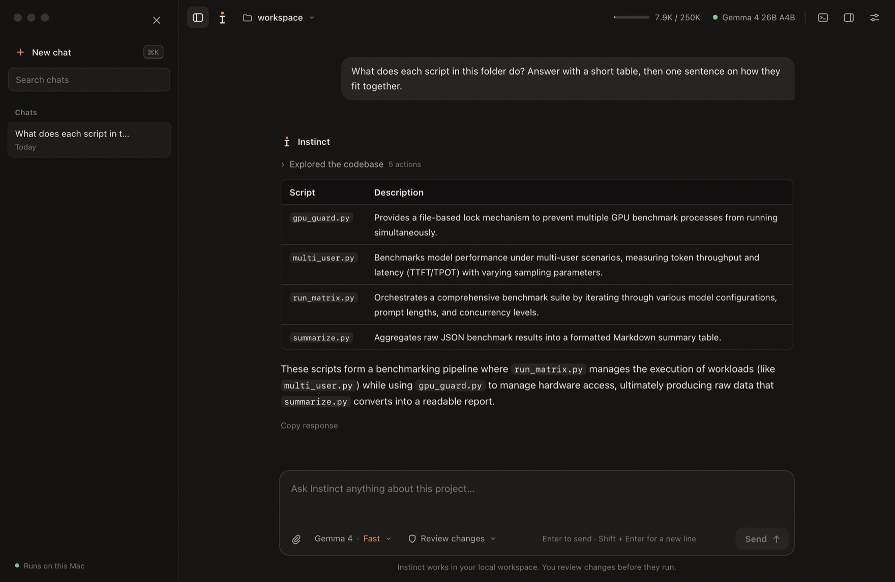

# Instinct

Instinct runs Gemma 4 and Qwen3.5 locally on Apple silicon. It includes a Mac
coding app and an inference engine you can use from Python.



The app streams replies and tool activity. Pick a project folder and choose
whether edits need review. You can rewind a chat and restore the files it
changed. Long chats reuse the prompt cache when possible and summarize older
turns as the context fills.

[Install and use the Mac app](docs/app.md). [Share your models with anyone, anywhere](docs/guests.md), with
their files kept on their own computer.

## The inference engine

Underneath is an LLM inference engine written from scratch in Python and C++,
with an Apple MLX/Metal backend and a CUDA backend. On Apple silicon it runs
the app's Gemma 4 (MoE, with images) and Qwen3.5 (hybrid linear attention)
straight from their 4-bit checkpoints, plus Qwen2 and Gemma 3 `.engine` files,
with paged KV arenas, continuous batching and custom Metal kernels. On NVIDIA
GPUs the same engine runs through MLX's CUDA backend with custom CUDA kernels.
PyTorch and
Transformers are only used to export weights, tokenize and check outputs;
they're never in the generation loop.

### What the engine does

- **Continuous batching.** Every running request decodes in the same forward
  pass, each with its own sampling settings. Long prompts are prefilled in
  chunks between decode steps.
- **Paged KV arenas.** Each layer stores keys and values in a shared arena that
  grows as pages are used. Requests reserve capacity before they start. Sliding
  windows release pages as they advance.
- **Split-K paged decode attention.** A Metal kernel that reads K/V straight
  from the arena, splits long contexts across threadgroups and serves every
  query head of a GQA group from one read.
- **Prefix caching** (opt-in). Finished requests and requested checkpoints
  keep their pages, so the next agent step or a sibling sharing a system prompt
  skips that prefill.
- **Model files.** A versioned, checksummed single-file format that both the
  Python and C++ readers validate before running anything.

### Performance

Qwen2.5-0.5B, FP16, Apple M3 Max, MLX 0.32.2. Each request generates 32 tokens;
throughput is total generated tokens per second over three runs after five
warmups. The first implementation stacked pages before each attention launch.
The second reads from the arena directly with the split-K Metal kernel.

| Prompt tokens | Concurrent requests | Stacked pages | Paged arena |
| ---: | ---: | ---: | ---: |
| 128 | 1 | 115.4 | 152.3 |
| 128 | 8 | 376.2 | 681.2 |
| 1,024 | 1 | 29.5 | 104.0 |
| 1,024 | 8 | 81.7 | 238.7 |

[Benchmark details](docs/benchmarks.md) cover latency, memory, a 32K prompt
smoke test and correctness checks against Transformers.
[Raw results](benchmarks/results/paged-arena-m3-max-2026-10-30/) include the
workload and run settings.

### Status

| Area | Where it stands |
| --- | --- |
| Qwen2.5 on MLX | Matches Transformers greedy output token for token (4 prompts × 32 tokens) |
| Gemma 3 on MLX | 3 of 4 continuations match exactly; the 4th diverges after 25 tokens at an FP16 near-tie |
| 256K context | Gemma 4 answers from a 262K-token prompt and releases every page afterwards; prefill takes 29 minutes |
| NVIDIA via MLX | Custom CUDA kernels for paged decode attention and Qwen3.5's gated delta rule, with a portable fallback. They compile for Turing through Hopper and match float64 references under a CPU emulator in CI, but **haven't run on an NVIDIA GPU yet**. An 8 GB RTX 3070 Ti runs Qwen3.5; Gemma 4 needs 20 GB or more. See [NVIDIA setup](docs/nvidia.md). |
| C++ CUDA engine | Compiles in CI. Reads only Qwen2 `.engine` files and **hasn't run on a GPU** |

See [docs/roadmap.md](docs/roadmap.md) for what's next.

### Running the engine

You need native arm64 Python 3.11+ and the Xcode command-line tools.

```bash
python3 -m venv .venv
source .venv/bin/activate
CMAKE_ARGS="-DINSTINCT_ENABLE_CUDA=OFF -DINSTINCT_BUILD_PYTHON=OFF" \
  pip install -e '.[mlx,export,test]'

instinct-export Qwen/Qwen2.5-0.5B-Instruct models/qwen2.5-0.5b.engine
```

```python
from transformers import AutoTokenizer
from instinct import create_engine

tokenizer = AutoTokenizer.from_pretrained("Qwen/Qwen2.5-0.5B-Instruct")
prompt = tokenizer.apply_chat_template(
    [{"role": "user", "content": "Explain paged KV caching."}],
    tokenize=True, return_dict=False, add_generation_prompt=True,
)

with create_engine(
    "models/qwen2.5-0.5b.engine",
    backend="mlx",
    max_num_sequences=8,
    kv_cache_bytes=512 << 20,
    prefill_chunk_size=512,
) as engine:
    output = engine.generate(prompt, max_new_tokens=64,
                             eos_token_ids=[tokenizer.eos_token_id])
    print(tokenizer.decode(output, skip_special_tokens=True))
```

For several concurrent requests, use `submit()`, then call `step()` until they
finish. `cancel()` and `stats()` are also available. [docs/setup-mlx.md](docs/setup-mlx.md)
covers Gemma export and the correctness tools, and [docs/setup-wsl.md](docs/setup-wsl.md)
covers building the C++ CUDA engine under WSL2. [docs/nvidia.md](docs/nvidia.md)
covers running the app on an NVIDIA PC (WSL2 or Linux), [docs/docker.md](docs/docker.md)
covers running it sandboxed in Docker, and [docs/pace.md](docs/pace.md)
covers benchmarking on an H100 on Georgia Tech's PACE ICE cluster.

## Also in this repo

**Gemma 4 and Qwen3.5.** Gemma 4 supports images. Qwen3.5 is text-only here. The default setup uses Gemma 4 26B A4B
(QAT 4-bit) as the main model and Qwen3.5-4B for sub-agents, both on the engine
through `ChatRunner`, which batches concurrent requests and reuses each
conversation's computed prefix across turns. One user gets about 65 tok/s from
Gemma and 76 from Qwen on an M3 Max; three at once get about 49 and 53 each.
See [docs/models.md](docs/models.md).

**Agent runtime.** Logical agents share a pool of model worker processes (local
or remote over authenticated HTTP), spawn bounded child agents, and journal
everything to SQLite so a run can resume after a crash. Workspace tools are
confined to one directory, with version-checked edits. See
[docs/agent-runtime.md](docs/agent-runtime.md).

## Tests

```bash
# C++ host components (CMake 3.24+, Ninja)
cmake -S . -B build -G Ninja -DINSTINCT_ENABLE_CUDA=OFF -DINSTINCT_BUILD_PYTHON=OFF
cmake --build build && ctest --test-dir build --output-on-failure

# Python. Metal tests run when mlx is installed and skip otherwise.
INSTINCT_INSPECT_MODEL=build/instinct-inspect-model PYTHONPATH=python python -m pytest -q
```

The Metal tests check tiny random Qwen and Gemma models against independent
references at page boundaries, with mixed-length batches, chunked prefill,
cancellation and the custom kernels on and off. CI runs the Python suite without model weights on Linux and macOS, a separate
MLX CPU job, the C++ tests under ASan/UBSan, a CUDA build and import check, and
an NVRTC compile of the MLX engine's CUDA kernels.

## Layout

| Path | |
| --- | --- |
| [python/instinct/](python/instinct/) | MLX engine, scheduler, paged KV store, model adapters, Metal kernels |
| [macos/](macos/) | The Mac app (Swift, WKWebView) and its build script |
| [python/instinct/harness/](python/instinct/harness/) | The app's server: chats, sandbox, terminal, web tools, checkpoints, UI |
| [python/instinct/agents/](python/instinct/agents/) | Agent runtime, workspace tools and model workers |
| [src/](src/), [include/instinct/](include/instinct/) | C++ model file reader, KV block pool, scheduler |
| [cuda/](cuda/) | CUDA Qwen graph, kernels, cuBLASLt wrapper, memory arenas |
| [benchmarks/](benchmarks/) | Benchmark drivers, prompt sets, saved FP16 results |
| [tests/](tests/) | Python and C++ tests |
| [docs/](docs/) | Design notes and write-ups ([architecture](docs/architecture.md), [design notes](docs/design-notes.md)) |
