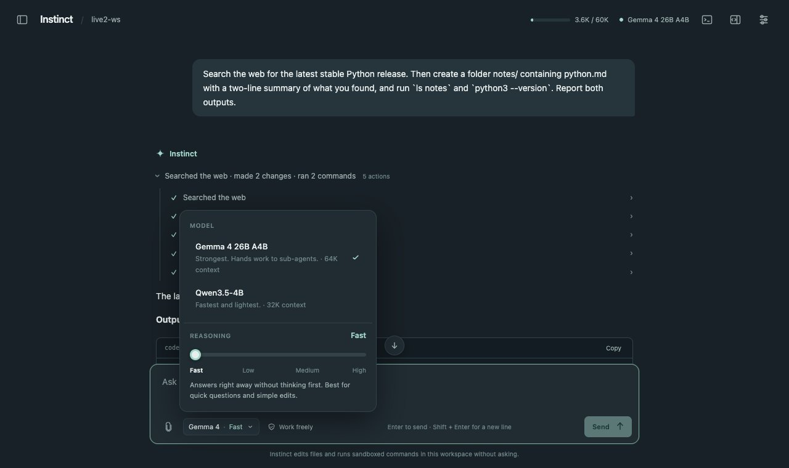
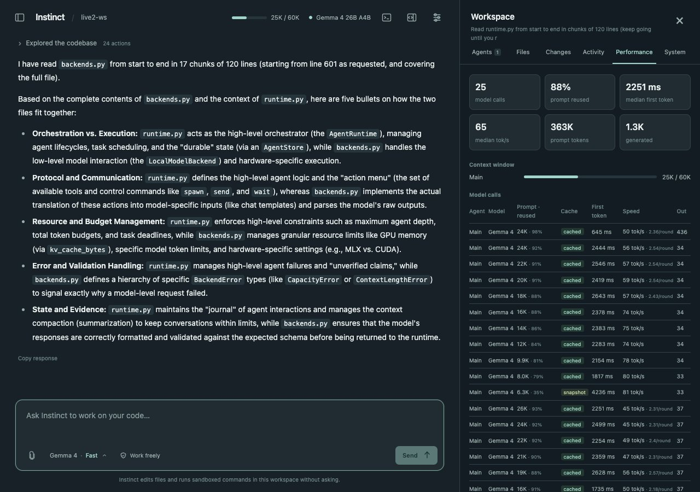

# Instinct

Instinct is a coding agent for the Mac that runs entirely on your machine.
Gemma 4 26B A4B does the work and hands parts of it to Qwen3.5-4B sub-agents.
It works in a folder of its own, where it can read, create, change and delete
files and run commands. Commands run in a sandbox that can't write anywhere
else.



## Install

```bash
pip install -e '.[mlx,vlm,agents]'      # into .venv
python -m instinct.prepare_models       # ~18 GB of models into models/
macos/build.sh --install                # builds ~/Applications/Instinct.app
```

The app runs the Python environment and models of the checkout it was built
from, so build it from the copy you want it to use. Without the models it starts
in demo mode, which exercises the interface without inference. It needs macOS 14
or later on Apple silicon. Gemma alone takes about 16 GB of memory, and the two
Qwen workers about 3.5 GB each while they run.

## The workspace and sandbox

The agent works in `~/Instinct` until you pick another folder with **File >
Open Folder** (⌘O). It keeps one set of chats per folder, in
`~/Library/Application Support/Instinct/workspaces/`.

- **File tools** can't reach outside the folder: list, read, search (text or
  regular expressions), write, edit, make folders, move and rename, and delete.
  Deleting moves things to the Trash.
- **Commands** run under macOS's Seatbelt sandbox. They can read your files but
  can only write inside the workspace and temporary folders, and they can reach
  the network only on localhost. To allow package installs and the like, turn on
  **Network for agent commands** in Settings. Commands can run for up to ten
  minutes.
- **Secrets stay out:** `.env` files, `.ssh`, `.aws` and the workspace's `.git`
  directory are off limits to the file tools. Commands don't inherit credentials
  from the environment.

## Permission modes

Pick a mode in Settings. It applies to new chats.

| Mode | What happens |
| --- | --- |
| Review changes | The agent reads freely and asks before each edit or command, showing the exact diff or argv |
| Work freely | Edits and sandboxed commands run without asking. Best for long tasks |
| Read only | The agent explores and answers but can't change anything |

## Models and reasoning

The button under the message box (for example "Gemma 4 · Fast") opens a panel
for the chat's model and a reasoning slider:

| Reasoning | What the model does |
| --- | --- |
| Fast | Answers without thinking first. Gemma's drafter speeds up tool calls |
| Low / Medium | Thinks for up to about 1,000 / 4,000 tokens first |
| High | Thinks as long as it needs, within the output limit |

Replies stream in as they are written. While the model thinks, its reasoning
shows in a collapsible block, which stays as "Thought" above the answer.
Sub-agents stream into their own cards. The Qwen workers start when a sub-agent
first needs one and stop after ten idle minutes.

## Rewind and edit

Hover over one of your messages to see **Edit** and **Rewind**.

- **Rewind** removes that message and everything after it, stopping a reply that
  is still running, and puts the message back in the box.
- **Edit** does the same and sends your new text in its place.

Both can also put the workspace's files back the way they were before that
message ran. Before each turn, the app commits the workspace to a private git
repository in its state folder, so changes made by commands are covered too. It
skips what the workspace's `.gitignore` excludes, plus virtualenvs,
`node_modules` and build output. Your own `.git` is never touched.

## Terminal

**View > Toggle Terminal** (⌃`) opens your login shell in the workspace, under
the same sandbox as agent commands. The terminal always has network access
(you're typing the commands), and it may write your shell history.

## Web

The agent can search the web (`web_search`, through DuckDuckGo) and read pages
(`fetch_url`, public addresses only, returned as text). Your search queries
leave the Mac. Turn **Web search and pages** off in Settings to keep everything
offline.

## Long tasks

Every agent step sends the whole conversation, so long tasks depend on the
prompt cache. The model only processes what is new since its last step; a
follow-up typically starts in under 100 ms. When an agent's context passes three
quarters of its budget, the agent writes a summary of its work so far, and older
messages are replaced by that summary. The prompt then grows by appending again.
The full history stays in the journal, and the agent can read it back with
`journal_read`. A run may take 200 steps per agent, 50M tokens and four hours.

## Everything else

| Action | How |
| --- | --- |
| New chat | ⌘N, or ⌘K in the page |
| Search chats | ⇧⌘F |
| Rename or delete a chat | Pencil or × on the chat in the sidebar |
| Stop the reply | Esc, or Stop |
| Context in use | The meter in the top bar; click it for the Performance tab |
| Workspace panel | ⇧⌘D: Agents, Files, Changes, Activity, Performance, System |
| Attach images | The paperclip, paste, or drop them on the box (up to 8, 16 MiB) |
| Show the workspace | ⇧⌘R reveals it in Finder |



The workspace panel's tabs:
- **Agents:** each agent's task, tools and results; you can direct or stop one.
- **Files:** what the agents created or edited, plus a browser for the folder.
- **Changes:** exact diffs, and the folder's own git changes.
- **Activity:** commands, tests and their output.
- **Performance:** every model call's prompt size, cache reuse, first-token
  time and speed.
- **System:** each model worker's memory and state.

## Running in a browser

The app is a native window around a local server, which also runs on its own:

```bash
.venv/bin/python tools/instinct.py                 # this repo as the workspace
.venv/bin/python tools/instinct.py --demo          # no models needed
instinct --workspace ~/code/project --config examples/agents-studio.json
```

It opens your browser with a one-time link and serves only on 127.0.0.1. Ctrl-C
or SIGTERM stops it and its model workers, and the workers also exit if the
server is killed.

## Optional extensions

Skills: pass `--skills-dir ./my-skills`. Each skill is a folder with a
`SKILL.md` that has `name` and `description` frontmatter. The agent loads a
skill's text on demand. Skill scripts never run automatically.

Local MCP servers: pass `--mcp-config ./mcp.json`:

```json
[
  {
    "name": "catalog",
    "command": ["/absolute/path/to/mcp-server", "--stdio"],
    "cwd": ".",
    "allowed_tools": ["lookup"],
    "timeout_seconds": 10
  }
]
```

Only the tools listed in `allowed_tools` are exposed. Their calls are always
reviewed, and they don't inherit credentials from the environment.

## State and limits

Chats, images, the agent journal, checkpoints and artifacts live in the state
folder: Application Support for the app, `.instinct/studio/` in the workspace
for the command line. The file tools can't read it. The server binds to
127.0.0.1 and checks the Host and Origin of every request. It authenticates the
page with an HttpOnly cookie and serves a strict content security policy.

The sandbox confines writes and network, not reads: a command can read anything
your user account can. On Linux there is no sandbox, and results say so. Remote
MCP servers, video uploads and scheduled tasks aren't supported.
