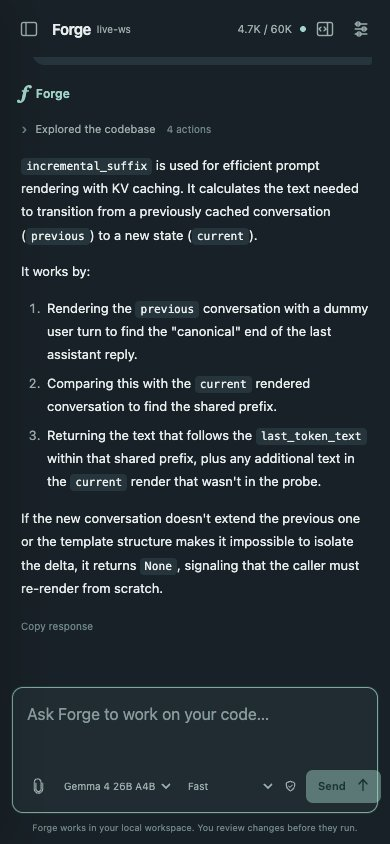
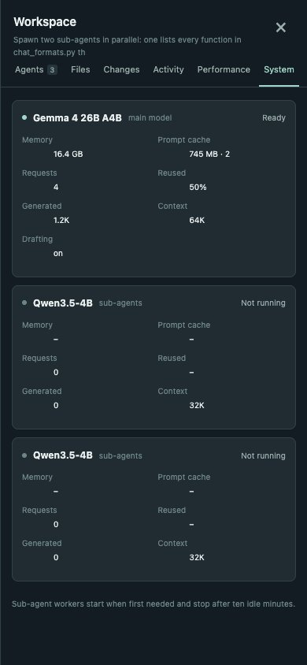

# Instinct

Instinct is a local assistant for the inference engine. Open it, type what
you need, and continue in the same conversation. Tools, delegated agents and
permissions appear inline when they are relevant.


Gemma 4 26B A4B answering with help from two Qwen3.5-4B sub-agents.

## Open and type

From the repository root, after `pip install -e '.[mlx,vlm,agents]'` and
`python -m instinct.prepare_models` (see [models.md](models.md)):

```bash
.venv/bin/python tools/instinct.py
```

On macOS, double-click `Instinct.command`. The launcher opens and authorizes
your browser, and warms the model in the background. You can submit your first
message while it loads; the prompt is saved and starts automatically when ready.
There is no separate backend-start step or task configuration screen.

After installing the package, the equivalent command is:

```bash
instinct --workspace . --config examples/agents-studio.json
```

Use `--port 8766` if the default port is occupied. Keep the launcher open while
using Studio. Ctrl-C or SIGTERM stops its model workers and preserves interrupted
work, and the workers also exit by themselves if the launcher is killed.
`--no-open` serves the app without authorizing a fresh browser.

## Conversation controls

| Action | Interaction |
| --- | --- |
| Send a prompt or follow-up | Enter, or Send |
| Insert a newline | Shift+Enter |
| Stop the current response | Escape, or Stop |
| Start fresh | New chat (Cmd/Ctrl+K); previous chats stay in history |
| Find an old chat | Search chats in the sidebar, or Cmd/Ctrl+Shift+F |
| Rename or delete a chat | Pencil or × on the chat in the sidebar; delete asks once more |
| Pick the model or reasoning effort | Selectors under the message box |
| See how full the context is | Meter in the top bar: this chat's prompt against its limit |
| Inspect a tool or delegated agent | Expand its inline activity row |
| Review a proposed change | Inspect the inline diff, then approve or decline |
| Adjust permissions | Settings; technical configuration stays out of the composer |
| Open developer tools | Workspace button, Cmd/Ctrl+Shift+D, or `/tasks`, `/files`, `/diff`, `/activity` |
| Reference a source file | Files panel: search, open, then Insert @path |
| Attach an image | Attach images, paste, or drop an image onto the composer |

## Models and reasoning effort

The default profile, `examples/agents-studio.json`, runs Gemma 4 26B A4B as the
main model and two Qwen3.5-4B workers for sub-agents. A chat can also be driven
by Qwen3.5-4B, which is faster and lighter but weaker. The choice and the effort
apply from the next message and are kept per chat.

| Effort | What the model does |
| --- | --- |
| Fast | Answers without thinking. Agent steps decode greedily, with Gemma's drafter where it helps |
| Think · low / medium | Thinks for up to 1,024 / 4,096 tokens first |
| Think · high | Thinks for as long as it needs, within the output limit |

Replies stream in as they're generated. While the model is thinking, its
reasoning shows in a collapsible block, which stays under the answer as
"Thought" afterwards. Sub-agents stream into their own cards.

The Qwen workers start when a sub-agent first needs one and stop after ten idle
minutes, so a chat that never delegates only holds Gemma in memory (about
16 GB). Each agent keeps to the worker that has its prompt cached; see
[vlm-runner.md](vlm-runner.md) for how prompts are reused.

## Developer workspace

The optional right panel has independent scrolling. On desktop it can stay open
beside the chat; on smaller screens it becomes a dismissible drawer.


- **Agents** shows assigned tasks, current tool operations, status, permissions,
  results and errors. Select an agent to save direction for its next model step
  or stop it. Stopping a child stops its subtree and lets the main agent handle
  the outcome; stopping the main agent stops the response.
- **Files** separates files created or edited by agents from the workspace
  browser. Search and open bounded text files with line numbers and syntax
  highlighting, copy paths, insert references, or download artifacts. A recorded
  file version is distinguished from the current file on disk.
- **Changes** shows exact proposed and applied diffs, their source agent and
  approval state. Failed or unconfirmed actions are not labeled as applied.
  Approval of an excerpt routes to the full review rather than silently granting
  permission against an incomplete preview. Current Git changes appear separately
  from agent receipts, including edits made outside the chat. Tracked files show
  HEAD diffs; untracked files show their current content rather than a fake diff.
- **Activity** shows tools, builds, tests and command output, with exit codes,
  bounded output, failures and timeouts. Ask Instinct to run a developer command
  in chat. `run_command` executes an explicitly reviewed argv array, with no
  implicit shell expansion; it does not provide an interactive terminal.
- **Performance** lists every model call in the chat: prompt size and how much
  of it came from the prompt cache, time to first token, decode speed, tokens
  per round when Gemma's drafter ran, and output length. Above the list are
  totals and each agent's context use.
- **System** shows each model worker: memory, prompt-cache size, requests,
  cache reuse, and whether it's ready, generating, starting or stopped.

<p>
  
  
</p>

Commands can run repository code and have the launcher's OS privileges. Review
the exact command before approval. Their working directory is confined to the
workspace, the inherited environment excludes credentials, and owned process
groups are stopped on cancellation, timeout or output-limit exhaustion. This
does not sandbox what the executable itself can access.

## Image attachments

PNG, JPEG, WebP and BMP images can be selected, pasted or dropped into a draft.
Preview or remove each attachment before sending. An image-only message is
supported. Up to eight images are accepted, with an 8 MiB per-image and 16 MiB
combined limit. Images follow the configured inference workers; the default
profile runs locally. They are not sent to an image-generation service.

Accepted images are validated, hashed and stored once in private state. Sent
thumbnails and full previews are authenticated and scoped to the conversation.
Follow-ups and delegated agents receive bounded prior image context, keeping
newer attachments when older ones exceed the limit. Gemma 4 and Qwen3.5 both
accept images; model pools that can't produce an explicit error.
Draft image bytes stay in the current browser tab's memory until sent; text
drafts continue to use session storage.

Follow-ups retain prior user messages and assistant replies in the same chat.
The model receives bounded conversation context, with the current request pinned
when older context is compacted. Old turns are dropped several at a time rather
than one per message, so the start of the prompt, and with it the model's prompt
cache, stays the same for a while. Chat history and accepted prompts persist across
browser refreshes and server restarts. While the assistant is busy, submitted
direction is saved and delivered without requiring a new task or a branch.

Read operations run without permission prompts. Review mode asks about concrete
edits, artifacts, test runs and selected MCP tool calls in the conversation.
An approval grants one invocation with exactly the displayed arguments. File
versions and proposed diffs are rechecked before editing. Read-only mode exposes
inspection tools without mutation tools. Child agents inherit a restricted tool
scope; their work appears inline and does not require switching to another view.

Logical agents have their own contexts and share the configured workers: the
main agent runs on the chat's model and sub-agents on the Qwen workers, two at a
time. Turn, token, context, deadline and concurrency limits still apply
internally. Failures appear in the conversation
with the submitted message preserved.

## Optional extensions

Select skill directories explicitly:

```bash
.venv/bin/python tools/instinct.py --skills-dir ./my-skills
```

Each skill is a child directory containing `SKILL.md` with simple YAML `name`
and `description` frontmatter. Discovery loads metadata; `skill_load` and
`skill_read` retrieve bounded text on demand. Skill scripts do not execute
automatically and skill prose cannot grant permissions.

Pass `--mcp-config ./mcp.json` to select local stdio tools:

```json
[
  {
    "name": "catalog",
    "command": ["/absolute/path/to/mcp-server", "--stdio"],
    "cwd": ".",
    "allowed_tools": ["lookup"],
    "timeout_seconds": 10
  }
]
```

An empty grant exposes no tools. MCP startup is owned by the backend lifecycle;
a failed extension is cleaned up before retry. The adapter supports 2026-07-28
stdio discovery/request metadata and legacy 2025-11-25 initialization, with
negotiated 2025-06-18/2025-03-26 compatibility. Calls are bounded, namespaced,
reviewed and non-replayable. Basic runtime environment values are forwarded;
credentials are not copied from the launcher's environment.

Python integrations can inject `HookRegistry` into `StudioService(hooks=...)`
and register trusted async `before_tool`/`after_tool` callbacks. Worker
configuration `acceptance` criteria support protected tests, JSON schemas,
child completion and required artifacts. Acceptance tests use the same review
boundary. Trace export and artifact download retain their existing endpoints.

## State and limits

Private state is in `.instinct/studio/`, ignored by Git. It stores conversations,
images, turns, the agent journal and run-specific text artifacts. File inspection
and edit tools cannot
read or overwrite this state, Git metadata or the existing private path classes.
The server binds to loopback and uses exact Host/Origin checks, JSON-only
mutations, an HttpOnly SameSite cookie and a restrictive content security policy.

These application controls are not an OS sandbox. Repository tests and selected
MCP executables run with the launcher's OS privileges. Interrupted uncertain
mutations and completion validators are not automatically replayed.

Replies, thinking and worker status arrive over one server-sent event stream
(`/api/events`); tool activity updates from the durable journal at action
boundaries. Video upload, remote MCP transports, OS/container isolation,
computer-use tools, scheduled jobs and multiple human accounts are not part of
Studio. Short video works through the runner API ([models.md](models.md)).

For an explicitly labeled deterministic harness exercise without inference:

```bash
.venv/bin/python tools/instinct.py --demo
```

The original mission APIs remain available for integrations, but the interactive
UI uses conversations. [harness-design.md](harness-design.md) covers how the
pieces fit together.

`benchmarks/smoke_studio.py`, `smoke_studio_chat.py` and `smoke_studio_image.py`
drive a running Studio end to end with a real model (a multi-turn chat, and an
image question) as a quick check after changes.
