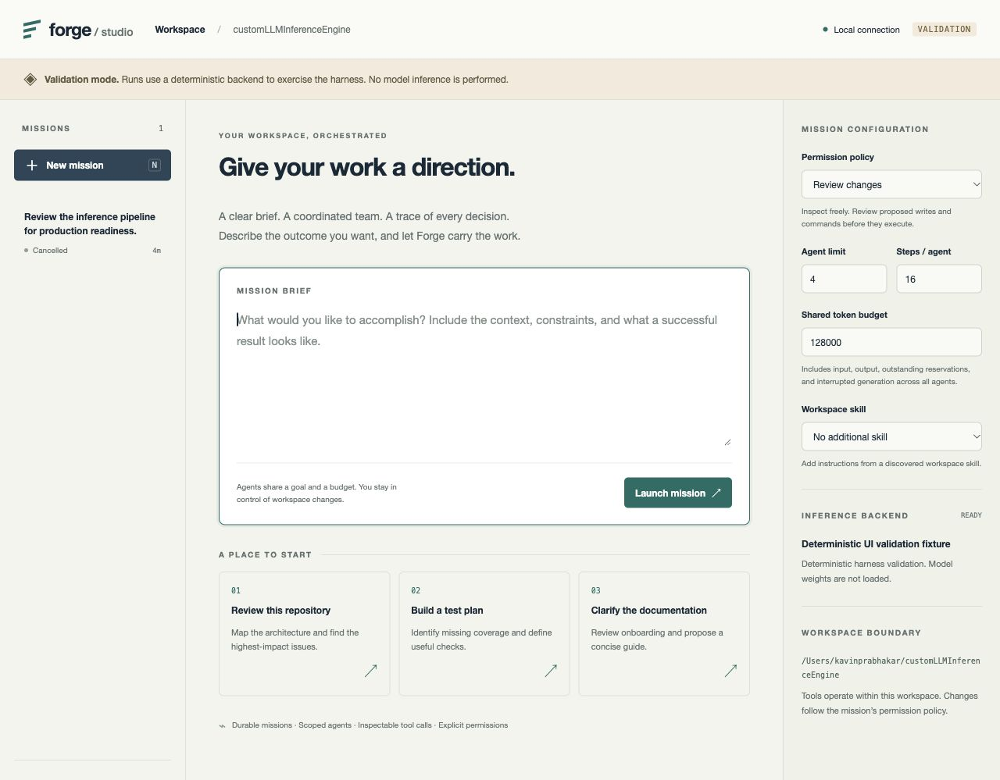

# Forge Studio

Forge Studio is a local mission workspace for the inference engine's durable
task agents. Give it a brief, inspect delegated work, review proposed changes
and collect the result and execution evidence. Its mission board, agent ledger
and activity timeline are intentionally separate from a terminal or chat feed.



Screenshot of the explicitly labeled deterministic UI validation fixture.

## Launch

From the repository root, using the existing Apple Silicon environment and
installed Qwen3.5 checkpoint:

```bash
.venv/bin/python tools/forge_studio.py
```

On macOS, double-click `Forge Studio.command`. The launcher opens your default
browser and authorizes that browser without printing or storing an access token.
Press **Start backend** to load the model, then write a brief and launch a mission.
The default profile loads one complete model replica; logical agents have separate
contexts but model generations share that replica. For two physical replicas,
use the existing `examples/agents-qwen35.json` worker configuration.

After installing the package, the equivalent command is:

```bash
forge-studio --workspace . --config examples/agents-studio.json
```

To check the harness without model inference:

```bash
.venv/bin/python tools/forge_studio.py --demo
```

The demo uses actual file tools, SQLite journaling, delegation and review, with
deterministic action selection. It displays **Validation mode** throughout.
It is not a language-model answer to your brief.

The server listens on `127.0.0.1:8765`. Use `--port 8766` if that port is occupied.
Stopping the launcher with Ctrl-C closes owned model/MCP processes and leaves
unfinished missions recoverable. `--no-open` is intended for headless operators;
it does not authorize a fresh browser. Keep the launcher open while using Studio.
The earlier native chat remains available through `tools/forge_chat.py`.

## Work with missions

- **Brief:** the shared objective, lineage and concrete proposed actions. Changes
  require a decision against the displayed arguments and diff. Declining an
  action feeds the rejection back to the agent; it may propose another action.
- **Agents:** independent roles, dependencies, context and tool scopes. Children
  are read-only by default. Explicit child permissions can only narrow or match
  their parent's permissions, and every mutation still passes review.
- **Activity:** model decisions, tool starts/results, messages, failures,
  compaction and completion checks. Expand an event to inspect its receipt.
- **Output:** delivered result and downloadable text artifacts. **Export trace** downloads
  a JSON record of the run, agents, events, usage and bound configuration.

**Read only** exposes inspection and configured skill reads. **Review changes**
adds guarded editing, artifact creation, configured tests and granted MCP tools.
Every effect needs a one-use approval. File edits retain per-agent read versions
and recheck the diff after review. All MCP tools require review regardless of the
server's descriptive annotations.

Use **Send direction** to steer an active agent; a generation already in flight
finishes with its saved input, and the next model turn receives the message.
**Stop mission** cancels the hierarchy. **Resume** recovers an interrupted run
within its original budget and deadline. Recovery checks workspace, model
fingerprints, worker configuration and extension catalog. It never grants new
permissions. A terminal mission supports a **follow-up** with a new budget and
a bounded copy of the previous result; the original stays immutable.
Recovery refuses uncertain mutations and interrupted completion validators.
An interrupted approval may therefore require a follow-up rather than replay.

The shared budget includes measured input/output, uncertain interrupted work,
and outstanding reservations. Reservations conservatively bound the next
generation, so a mission may reach its budget before the measured count alone
reaches that limit. Studio allows at most four active missions, in addition to
the configured per-mission hierarchy, turn, context and deadline limits.

## Skills and MCP

Select skill directories explicitly; Studio does not scan your home directory:

```bash
.venv/bin/python tools/forge_studio.py --skills-dir ./my-skills
```

Each skill lives in a child directory with a `SKILL.md`, a `name` and `description`
in simple YAML frontmatter. Discovery loads only metadata. Choosing a skill loads
its body into the mission; agents can load catalogued skills and relative text
resources through bounded tools. No skill scripts execute automatically, and
skill prose cannot change permissions. Large skill bodies can exceed the brief
bound; agents can load those progressively with `skill_load`.

For MCP, pass `--mcp-config ./mcp.json` with an explicit operator-owned list:

```json
[
  {
    "name": "catalog",
    "command": ["/absolute/path/to/mcp-server", "--stdio"],
    "cwd": ".",
    "allowed_tools": ["lookup"],
    "timeout_seconds": 10
  }
]
```

An empty tool grant exposes no tools. These are selected executable processes,
not model-generated commands. MCP startup occurs when the backend starts; a
broken extension prevents ready state and is cleaned up before retry. The
adapter supports current **2026-07-28** stdio discovery/request metadata and
legacy **2025-11-25** initialization, with negotiated 2025-06-18/2025-03-26
compatibility. Tests exercise both current and legacy subprocess protocols.
Calls are bounded, namespaced and non-replayable; timeouts/cancellation terminate
the owned process group. Only basic runtime environment values are forwarded.

For Python integrations, inject a `HookRegistry` into `StudioService(hooks=...)`.
Register trusted async `before_tool` and `after_tool` callbacks. Before hooks
can reject execution; after-hook failures are recorded without pretending an
already executed tool was rolled back. Hooks are ordered and time-bounded.
Existing worker configuration `acceptance` criteria support protected tests,
JSON schemas, child completion and required artifacts. Acceptance test execution
uses the same review gate and preserves the original test fingerprints.

## State and verification

Private state lives in `.forge/studio/` (ignored by Git), with an owner-only
SQLite journal and run-specific artifact directories. Workspace tools cannot
read or overwrite Studio state, Git metadata or the existing private path
classes. The local server uses exact Host/Origin checks, JSON-only mutations,
an HttpOnly SameSite cookie and a restrictive content security policy.

These are application controls, not an operating-system sandbox. Repository
tests and selected MCP executables run with the launcher's OS privileges;
choose trusted programs. The server is intended for one local operator.

Portable tests cover scheduling, approval races, cancellation, recovery,
confinement, extension lifecycle and real HTTP requests. The
[local integration report](../benchmarks/results/forge-studio-2026-10-11/)
records the separately executed Qwen3.5 fixture smoke. Neither deterministic
tests nor one local fixture establishes broad agent reliability.

This release streams activity by polling the durable journal at action
boundaries. Token streaming, media upload in Studio, remote MCP transports,
containers/worktree isolation, computer-use tools, multi-user collaboration
and scheduled background jobs are not implemented. Text/image/video model
execution remains available through the engine and the earlier chat/CLI APIs.

See the [design](harness-design.md) for architecture and public references.
