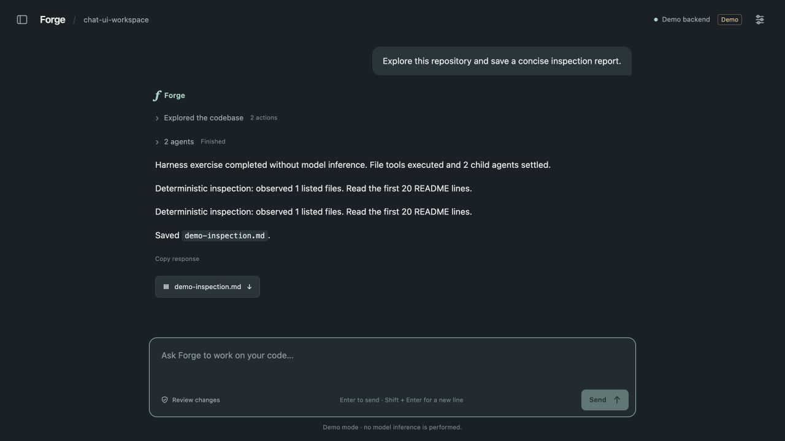

# Forge Studio

Forge Studio is a local assistant for the inference engine. Open it, type what
you need, and continue in the same conversation. Tools, delegated agents and
permissions appear inline when they are relevant.



Actual HTTP-backed browser QA using the explicitly labeled deterministic demo.

## Open and type

From the repository root, with the existing Python environment and Qwen3.5
checkpoint installed:

```bash
.venv/bin/python tools/forge_studio.py
```

On macOS, double-click `Forge Studio.command`. The launcher opens and authorizes
your browser, and warms the model in the background. You can submit your first
message while it loads; the prompt is saved and starts automatically when ready.
There is no separate backend-start step or task configuration screen.

After installing the package, the equivalent command is:

```bash
forge-studio --workspace . --config examples/agents-studio.json
```

Use `--port 8766` if the default port is occupied. Keep the launcher open while
using Studio. Ctrl-C closes its owned workers and preserves interrupted work.
`--no-open` serves the app without authorizing a fresh browser.
The earlier native chat remains available through `tools/forge_chat.py`.

## Conversation controls

| Action | Interaction |
| --- | --- |
| Send a prompt or follow-up | Enter, or Send |
| Insert a newline | Shift+Enter |
| Stop the current response | Escape, or Stop |
| Start fresh | New chat; previous chats stay in history |
| Inspect a tool or delegated agent | Expand its inline activity row |
| Review a proposed change | Inspect the inline diff, then approve or decline |
| Adjust permissions | Settings; technical configuration stays out of the composer |

Follow-ups retain prior user messages and assistant replies in the same chat.
The model receives bounded conversation context, with the current request pinned
when older context is compacted. Chat history and accepted prompts persist across
browser refreshes and server restarts. While the assistant is busy, submitted
direction is saved and delivered without requiring a new task or a branch.

Read operations run without permission prompts. Review mode asks about concrete
edits, artifacts, test runs and selected MCP tool calls in the conversation.
An approval grants one invocation with exactly the displayed arguments. File
versions and proposed diffs are rechecked before editing. Read-only mode exposes
inspection tools without mutation tools. Child agents inherit a restricted tool
scope; their work appears inline and does not require switching to another view.

The launcher profile loads one complete model replica. Logical agents have their
own contexts and share that replica. For two physical replicas, select the existing
`examples/agents-qwen35.json` worker configuration. Turn, token, context, deadline
and concurrency limits still apply internally. Failures appear in the conversation
with the submitted message preserved.

## Optional extensions

Select skill directories explicitly:

```bash
.venv/bin/python tools/forge_studio.py --skills-dir ./my-skills
```

Each skill is a child directory containing `SKILL.md` with simple YAML `name`
and `description` frontmatter. Discovery loads metadata; `skill_load` and
`skill_read` retrieve bounded text on demand. Skill scripts do not execute
automatically and skill prose cannot grant permissions.

Pass `--mcp-config ./mcp.json` to select local stdio tools:

```json
[
  {
    "name": "catalog",
    "command": ["/absolute/path/to/mcp-server", "--stdio"],
    "cwd": ".",
    "allowed_tools": ["lookup"],
    "timeout_seconds": 10
  }
]
```

An empty grant exposes no tools. MCP startup is owned by the backend lifecycle;
a failed extension is cleaned up before retry. The adapter supports 2026-07-28
stdio discovery/request metadata and legacy 2025-11-25 initialization, with
negotiated 2025-06-18/2025-03-26 compatibility. Calls are bounded, namespaced,
reviewed and non-replayable. Basic runtime environment values are forwarded;
credentials are not copied from the launcher's environment.

Python integrations can inject `HookRegistry` into `StudioService(hooks=...)`
and register trusted async `before_tool`/`after_tool` callbacks. Worker
configuration `acceptance` criteria support protected tests, JSON schemas,
child completion and required artifacts. Acceptance tests use the same review
boundary. Trace export and artifact download retain their existing endpoints.

## State and limits

Private state is in `.forge/studio/`, ignored by Git. It stores conversations,
turns, the agent journal and run-specific text artifacts. Workspace tools cannot
read or overwrite this state, Git metadata or the existing private path classes.
The server binds to loopback and uses exact Host/Origin checks, JSON-only
mutations, an HttpOnly SameSite cookie and a restrictive content security policy.

These application controls are not an OS sandbox. Repository tests and selected
MCP executables run with the launcher's OS privileges. Interrupted uncertain
mutations and completion validators are not automatically replayed.

Activity is updated from the durable journal at action boundaries. Token-by-token
answer streaming, Studio media upload, remote MCP transports, OS/container
isolation, computer-use tools, scheduled jobs and multiple human accounts remain
outside this release. Text/image/video model execution remains available in the
engine and earlier chat/CLI APIs.

For an explicitly labeled deterministic harness exercise without inference:

```bash
.venv/bin/python tools/forge_studio.py --demo
```

The original mission APIs remain available for integrations, but the interactive
UI uses conversations. The [design](harness-design.md) documents the current
interaction model and the underlying runtime boundaries.
The [conversation validation report](../benchmarks/results/forge-studio-conversation-2026-10-11/)
records the real-model three-turn check and browser interaction scope.
